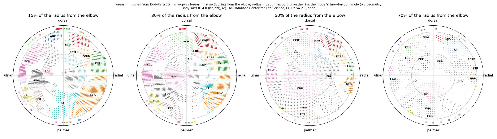

# Forearm muscle anatomy (BodyParts3D atlas)

Where each forearm muscle sits in the cross-section decides what every electrode records. The musculoskeletal model
only has each muscle's line of action (the tendon path MyoSim inherits from MoBL-ARMS), and those lines are placed
for their moment arms, not for their volume: at the band, brachioradialis came out dorsal, FCU palmar and nothing
covered the ulnar side. `EMGParams.anatomy = "atlas"` (the default) puts the muscles where a 3D anatomical atlas
has them; `"lines"` keeps the old geometry.

Four slices at 15, 30, 50 and 70 % of the radius from the elbow, seen from the elbow, in myogen's forearm frame
(0 radial, +90 dorsal, ±180 ulnar, -90 palmar). The radial coordinate is the depth fraction (1 = the outer muscle
surface, below the fat); grey is the radius and the ulna; the crosses on the rim are the angles the model's lines
of action give the same muscles (the old geometry). Numbers per muscle and level: [anatomy/levels.csv](anatomy/levels.csv).

## Source

- **BodyParts3D** release 4.0, IS-A tree, 99 % reduced Wavefront meshes (`isa_BP3D_4.0_obj_99.zip`, 143 MB) from
  <https://dbarchive.biosciencedbc.jp/en/bodyparts3d/download.html>. One body, in the anatomical position.
- Licence: CC BY-SA 2.1 Japan, "BodyParts3D, (c) The Database Center for Life Science licensed under CC
  Attribution-Share Alike 2.1 Japan". The derived files (`src/myogen/models/forearm_anatomy.npz`, `docs/anatomy/`)
  carry that licence (`src/myogen/models/LICENSE-BodyParts3D`), the simplified muscle surfaces in the npz included;
  the original meshes are not in the repository.
- Rebuild: download and unzip the archive, then
  `pip install -e ".[model-build]"` and `python src/myogen/models/build_anatomy.py <unzipped folder>` (about 3 min).

Meshes used (right side; FJ = BodyParts3D element file):

| model muscle | BodyParts3D | | model muscle | BodyParts3D |
|---|---|---|---|---|
| BRD | FJ1487 brachioradialis | | FDS2-5 | FJ1475 + FJ1499 flexor digitorum superficialis |
| ECRL | FJ1490 | | FDP2-5 | FJ1497 flexor digitorum profundus |
| ECRB | FJ1489 | | EDC2-5 | FJ1492 extensor digitorum |
| ECU | FJ1472 + FJ1517 | | EDM | FJ1491 |
| FCR | FJ1496 | | EIP | FJ1493 extensor indicis |
| FCU | FJ1473 + FJ1518 (humeral and ulnar heads) | | EPL, EPB | FJ1495, FJ1494 |
| PL | FJ1502 | | FPL, APL | FJ1498, FJ1484 |
| PT | FJ1474 + FJ1516 (humeral and ulnar heads) | | SUP, ANC | FJ1505, FJ1485 |
| PQ | FJ1503 | | bones | FJ3349 radius, FJ3391 ulna |

The upper-arm muscles of the model (TRI, BIC, BRA) are not in the atlas and keep their lines of action; they are
above the elbow, outside every band.

## Method (`build_anatomy.py`)

1. **Forearm axis**: the main axis of the radius and ulna vertices, pointing to the radial styloid. Levels run along
   the radius: 0 at the top of its head, 1 at the styloid tip (-0.15 to 1.05 in steps of 0.025).
2. **Voxels**: at every level, a 1 mm grid in the plane perpendicular to the axis; a voxel belongs to a muscle when
   its generalised winding number with the muscle's mesh is above 0.5 (robust to the holes of the reduced meshes).
3. **Cross-section**: at every level, the centre of all tissue (muscles and bones), and the tissue envelope per 10°
   (98th percentile radius, smoothed). Each voxel becomes (level, angle around the centre, depth fraction = radius /
   envelope at that angle). Normalising by the envelope maps the atlas's oval section onto myogen's round one while
   keeping each muscle's relative depth.
4. **Frame**: the atlas is in the anatomical position, so lateral (BodyParts3D -x on the right side) is radial and
   posterior is dorsal, as in myogen's frame. No rotation is fitted (see Checks).
5. **Finger compartments**, per level, as heuristics: FDP and EDC split in four equal volumes from the radial to the
   ulnar side (index radial); FDS in a superficial layer (middle, ring) and a deep one (index, little), each split
   radial / ulnar.
6. **Samples**: 400 voxels per model muscle, uniformly over its volume, stored as (level, angle, depth fraction).
7. **Surfaces** (for drawing): every model muscle's voxels (finger compartments included), and the radius's and
   ulna's, are rasterised on a 1 mm grid in the normalised (round) section, closed and filled slice by slice,
   smoothed (Gaussian, 1.2 mm), interpolated between levels and iso-surfaced (marching cubes, at 0.4: 90 % of a
   muscle's samples fall inside its surface, against 81 % at 0.5, with little overlap). Pieces below 5 % of
   the volume (thin distal tendons that break off) are dropped; the mesh is simplified to 2500 triangles and Taubin
   smoothed. Vertices are stored as (level, angle, depth fraction) like the samples, so `Anatomy` varies them per
   subject and `EMGModel.muscle_surfaces(d)` places them at any pose exactly as it places the EMG points. They
   are for display only: the EMG never reads them.

## How myogen uses it (`simulation/anatomy.py`)

- Levels become distances from the elbow on the model's own radius (head and styloid of its mesh); depth fractions
  become radii in the subject's cross-section (skin radius minus fat, so the forearm size, taper and fat of each
  `Subject` apply).
- **Posture**: each atlas point follows its muscle's belly in the musculoskeletal model, at the belly point nearest
  in height: the point moves by the belly's displacement from the reference pose (scaled to the subject's
  section). The cross-section comes from the atlas, the motion (pronation, muscle shortening) from the model.
  The bellies are taken with the elbow at the atlas's reference angle: the forearm frame rides on the ulna, so the
  elbow angle only swings the humeral origins of BRD, ECRL and the common flexor and extensor heads around it (at the
  default 72° it pushed BRD 6 cm out of the limb, and the engines then pressed it flat under the fat).
- **Motor units** sit at a random atlas point of their muscle (a point of its volume, so large muscles spread their
  units).
- Speed: placing the points is vectorised (with `belly_points`), so 10 s of 16-channel motor-unit EMG takes 1.6 s
  (3.0 s before, with the lines).

## Variation between subjects (`Subject`)

The atlas is one body; each `Subject` varies it (all off by default, `Subject.random(seed)` draws every one):

| field | effect | `Subject.random` |
|---|---|---|
| `strength` | maximal force of every muscle (mechanics: a stronger muscle needs less drive); unit action potentials ~ strength^0.5 (larger fibres) | 0.7-1.3 |
| `muscle_strength` (per muscle) | force factor on top of `strength` | lognormal, σ 0.15 |
| `muscle_size` (per muscle) | the muscle's spread around its centre at each level (area ~ size) and its number of motor units | lognormal, σ 0.15 |
| `muscle_shift_deg` (per muscle) | turned around the forearm | normal, σ 5° |
| `muscle_depth` (per muscle) | depth below the muscle surface scaled (< 1: nearer the skin) | lognormal, σ 0.1 |
| `section_rotation_deg` | the whole section turned against the skin and the band | uniform ±15° |

Forearm rotation comes only from the motion (`pro_sup_r`, when the hand tracking gives it); untracked, the
forearm stays at the model's rest (supinated, as the atlas body).

`Subject.build(strength, fat_mm)` sets both and derives the forearm radius: fat plus a muscle radius growing with
sqrt(strength) (force ~ cross-sectional area). `Subject.preset(name)`: `reference` (the default subject, strength 1,
5 mm fat), `low_strength` (0.7), `high_strength` (1.3), `low_fat` (2 mm), `high_fat` (9 mm). Per-muscle
lists are in the model's muscle order (`ForearmModel().muscle_names`).

## Checks

- Muscle order around the arm matches textbook sections of a supinated forearm, palmar from the radial side:
  BRD, PT, FCR, PL, FDS, FCU; dorsal: ECRL, ECRB, EDC, EDM, ECU, ANC (proximal).
- Bone centres, atlas vs model at its default pose (degrees):

  | level | radius atlas | radius model | ulna atlas | ulna model |
  |---|---|---|---|---|
  | 0.5 | 18 | 49 | 145 | 170 |
  | 0.7 | 17 | 32 | 169 | 173 |
  | 0.9 | 11 | 15 | 177 | 156 |

  They agree within ~20° from mid-forearm to the wrist. Proximally the model puts the radius dorsal (94° at 0.1):
  its forearm frame axis runs from the elbow joint to the lunate, off the bones' centre there.
- At 30 % (under a band), atlas vs lines of action: BRD -33° vs 67°, ECRL 19° vs 87°, ECU 89° vs 142°, FCR -118°
  vs -81°, PL -142° vs -83°, FCU 167° vs -100°, EDC3 59° vs 92°. Superficial muscles are now 0.85-0.95 of the
  radius (EDC 6-9 mm below the fat) instead of 12-21 mm deep.

## Limitations

- **One body**, one posture: no variation between people yet beyond the forearm size, taper and fat of `Subject`
  (next: per-subject rotation and scaling of the section, and per-muscle size).
- **Frame**: the atlas arm is in the anatomical position, but its exact supination is not measured; an error of
  10-20° in the whole section's rotation is possible. Note also that in a supinated forearm the wrist flexors'
  centre (FCR, PL, FCU) is ulnar-palmar (-169° at 10-50 %) and the extensors' (ECRL, ECRB, ECU) dorsal-radial
  (+43°), not at -90 / +90: a band
  frame anchored on "wrist flexion is palmar" is rotated from the anatomical one.
- **99 % reduced meshes**: about 1 cm of geometric detail; thin muscles (EDM, PL) are coarse.
- **Finger compartments** of FDS, FDP and EDC are split by rule, not segmented.
- No tendons as separate structures: a muscle's distal tendon is part of its mesh and gets few samples (it has
  little volume), which is the right weighting for EMG.
