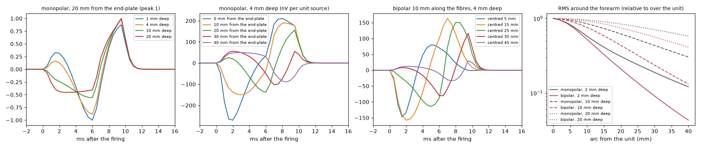

# Volume conductor (motor-unit waveforms)

`MotorUnitParams.waveform = "volume_conductor"` gives every motor unit the action potential a layered forearm
conducts to each electrode pole, instead of a Gaussian derivative with an exponential gain (`"biphasic"`, the
default until it is validated on the datasets). Code: `src/myogen/simulation/volume_conductor.py`; parameters:
`VolumeConductorParams` in `params.py`.

(`python docs/volume_conductor/plot_muaps.py`: the average subject's forearm under a band, 36 mm skin radius, 5 mm
fat.) Deeper units give smaller and slower waveforms; the potential travels from the end-plate at 4 m/s and a
standing component appears when it reaches the tendons; a bipolar pair cancels what both poles see alike, so it
loses deep and lateral units faster than a single pole.

## Model

1. **Field of a point source** (`LayeredCylinder`): concentric layers, a central bone (one cylinder standing for the
   radius and the ulna), anisotropic muscle (0.1 S/m across the fibres, 0.5 along), fat, skin, and no current out of
   the skin; tissue values after Farina et al. 2004 (IEEE TBME 51:415). In the Fourier domain (axial wavenumber k,
   angular order m) each layer's potential is a combination of modified Bessel functions I_m and K_m; continuity of
   the potential and of the normal current at the three interfaces and no current through the skin give 7 linear
   equations per (k, m). Written from these boundary conditions for myogen (MIT), not taken from another code. The
   coefficients are normalised at their own interface and the Bessel functions taken in log space, so the system
   stays finite for large k * radius and high angular orders. A round electrode of radius 2.5 mm averages the
   field.
2. **A fibre** (`_fibre_current`): the Rosenfalck intracellular action potential starts at the end-plate and
   travels both ways at the conduction velocity, inside the fibre only (60 mm, its end-plate in the middle); the
   membrane current is the second derivative along the fibre of the windowed potential, so the sources where the
   potential starts (end-plate) and stops (tendons) come out of the windowing. A unit's fibres end at scattered
   tendon junctions (±6 mm).
3. **A unit** (`MUAPTable`): the fibre waveform at every grid point (depth below the muscle surface 0.5-33 mm,
   angle 0-180° in 2.5° steps, pole distance from the end-plate ±200 mm in 2 mm steps: a monopolar pole sees the far ends of long muscles), blurred over the unit's
   territory (2 mm) and end-plate scatter (5 mm).
4. **Compression**: the waveforms are about 12 ms (24 samples at 2 kHz) and smooth, so 10 principal components of
   their shapes reproduce them (shape error < 0.001 for 99 % of the table). Each spike adds its 10 weights
   (trilinear lookup) into 10 impulse trains per pole, each convolved once: the cost of the width bands.
5. The table depends on the subject's forearm radius (at the electrodes' mean height) and fat; it is built in
   ~10-15 s and cached in `~/.cache/myogen` (`MYOGEN_CACHE` to move it). Unit amplitudes are normalised as before:
   a fully driven superficial muscle (4 mm below the fat) under a pole 20 mm from its end-plates gives the
   subject's `gain_mv`.

Bipolar channels are the difference of the two poles' waveforms (no extra delay: each pole's waveform already
propagates). Unit positions are the atlas anatomy's (`docs/anatomy.md`), moved with the posture.

## Checks

- With one conductivity in every layer and a large radius, the potential of a shallow source matches the half-space
  solution I / (2πσr) within 5 % (differences between points: the model leaves out the zero axial wavenumber, a
  constant a fibre's sources never excite) — `tests/test_volume_conductor.py`.
- Bipolar loses deep and lateral units faster than monopolar (same file).
- Bipolar median frequency 82-111 Hz depending on depth (biphasic engine 45-55, recordings 21-63 Hz after their
  devices' filters): `iap_lambda` < 1 (longer action potentials) and `conduction_velocity` lower it.

## On the datasets

Known-placement comparison (`docs/realism_plan.md`): more realistic spatial statistics than the biphasic waveforms
(ring patterns, correlation with distance, rest / move), lower transfer of a decoder trained on it on EMG-FK and
DB8. Not the default yet.

## Limitations

- One central bone, round section: the real section is oval with two bones off-centre.
- Fibres parallel to the forearm axis (forearm muscles are mostly fusiform or slightly pennate).
- Every unit has the same fibre length and conduction velocity.
